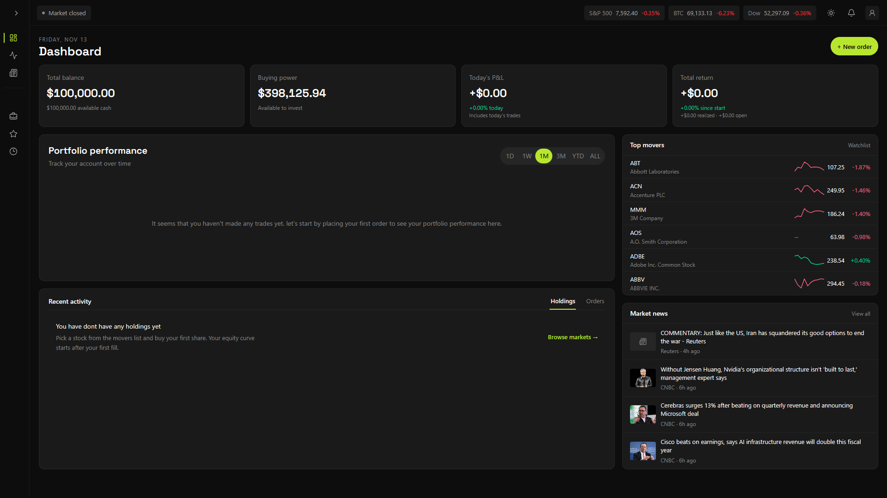
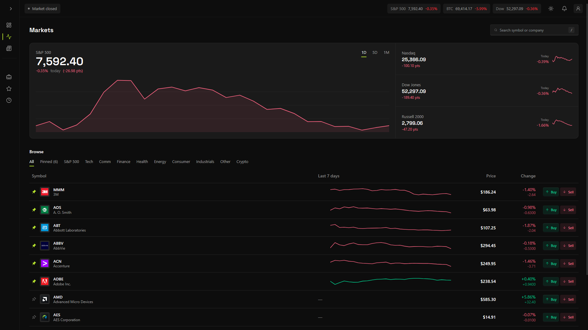
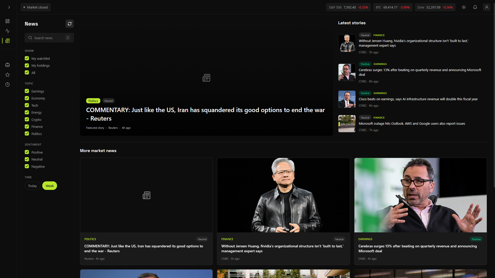
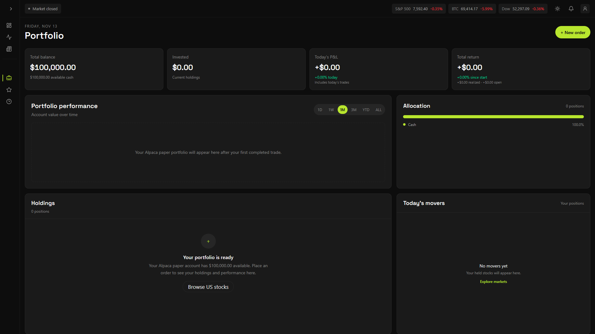
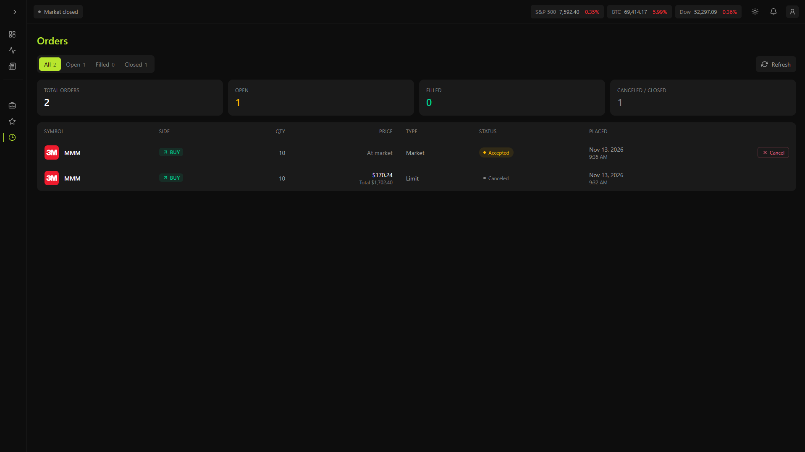
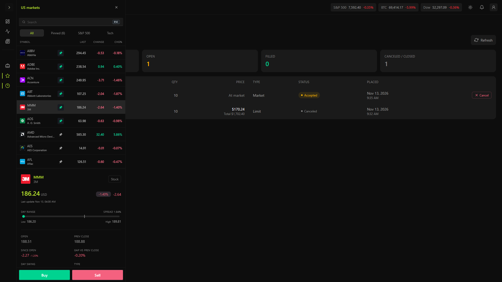

# Paper Trade

A paper trading web app for practicing US stock trading with virtual money. It uses live market data from Finnhub and Alpaca, and places orders through Alpaca's **paper trading** API, so no real funds are ever at risk.

> ⚠️ **Private use only.** The app has no user sign-in. Use paper-account credentials and keep it running locally or on a private network.

## Features

- **Real market data**: US stock symbols, quotes, and news from Finnhub; candles from Alpaca IEX.
- **Paper trading**: place and track orders against Alpaca's paper endpoint.
- **Order fill notifications**: the app checks paper orders every 30 seconds and shows an in-app notification when an order fills. These are not push notifications and only appear while the app is open.
- **Market hours**: the navbar shows US market hours from Alpaca.
- **Synced pins**: pinned symbols sync with a dedicated `PaperTrade` watchlist in Alpaca. If the watchlist doesn't exist, the app creates it and seeds it with the pins saved in your browser. Later changes are written to Alpaca, and remote changes refresh while the app is open.

## Tech Stack

- [Next.js](https://nextjs.org) (App Router) with TypeScript
- ESLint
- [Finnhub](https://finnhub.io) for symbols, quotes, and news
- [Alpaca](https://alpaca.markets) for candles and paper trading
- [Geist](https://vercel.com/font) font via `next/font`

## Getting Started

### Prerequisites

- Node.js 20 or newer (TODO: confirm the minimum version)
- A [Finnhub](https://finnhub.io) API key
- An [Alpaca](https://alpaca.markets) **paper trading** account and API keys

### Installation

```bash
git clone https://github.com/JuisLionel/Paper_Trade.git
cd Paper_Trade
npm install
```

### Environment Variables

Create a `.env.local` file in the project root:

```env
FINNHUB_KEY=your_finnhub_key
APCA_API_KEY_ID=your_alpaca_paper_key_id
APCA_API_SECRET_KEY=your_alpaca_paper_secret_key
```

| Variable | Used for |
| --- | --- |
| `FINNHUB_KEY` | US stock symbols, quotes, and news |
| `APCA_API_KEY_ID` | Alpaca IEX candles and paper trading |
| `APCA_API_SECRET_KEY` | Alpaca IEX candles and paper trading |

These are read on the server only. Never expose them in client-side code or commit them to source control.

### Run the Development Server

```bash
npm run dev
```

Open [http://localhost:3000](http://localhost:3000) in your browser.

### Production Build

```bash
npm run build
npm run start
```

## Project Structure

```
Paper_Trade/
├── app/              # Next.js App Router pages, layouts, and API routes
├── lib/              # Shared helpers and API clients
├── types/            # TypeScript type definitions
├── public/preview/   # Preview images
├── proxy.ts          # Request proxy
├── next.config.ts
└── eslint.config.mjs
```

## Security Notes

- Trading routes always use Alpaca's **paper** endpoint and reject non-local hosts.
- There is no authentication, so don't deploy this publicly.
- Keep `.env.local` out of version control (it is already covered by `.gitignore`).

## Known Limitations

- Binance USDT crypto symbols may be rejected if Alpaca doesn't support that pair in watchlists.
- Fill notifications only work while the app is open in the browser.

## Screenshots

| | | |
| --- | --- | --- |
|  |  |  |
| **Dashboard** | **Markets** | **Trading** |
|  |  |  |
| **Watchlist** | **Orders** | **Light Theme** |
## License

This project is licensed under the [MIT License](LICENSE).